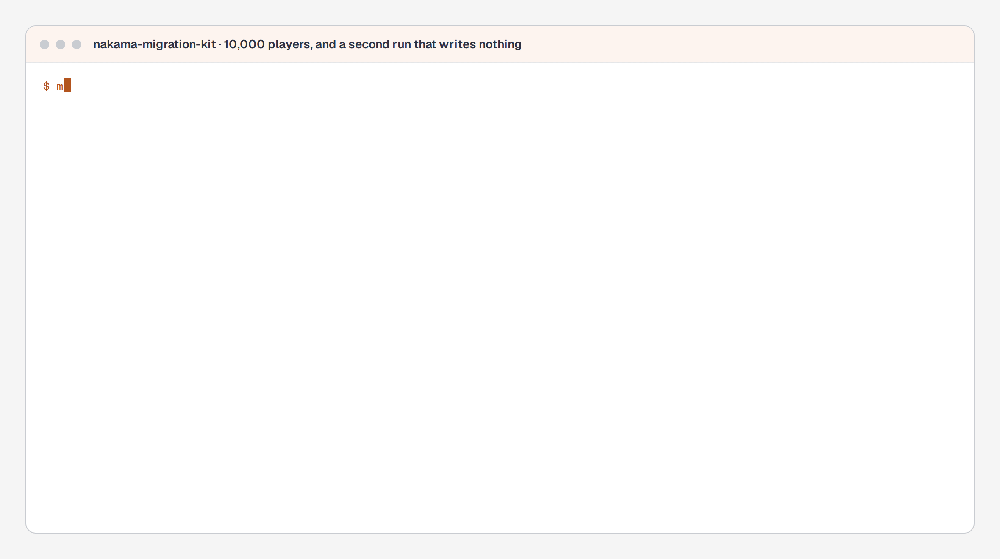

# nakama-migration-kit

[](https://github.com/lasttoss/nakama-migration-kit/actions/workflows/ci.yml)

Move a live title's players off a legacy backend and into self-hosted Nakama, and be able to say with
a number that the second run wrote nothing.

```
make demo        # 10k players imported twice against a real Nakama, with a reconciliation in between
make demo-crash  # a run killed mid-batch, and the run that finishes it
```

## The whole migration, in one command



*`make demo`. The second run is not fast because it skipped the work - it did the same work with the writes withheld. The output is the command's; the pauses between lines are the recording's.*


## What it does, measured

`make demo` starts a fake legacy title, a PostgreSQL and a Nakama, imports the title, imports it
again, and then reconciles the target against the source. The numbers below are from that run, not
from a projection:

| | |
|---|---|
| players in the title | 10,000 |
| documents written, first run | 47,500 |
| documents written, second run | **0** (47,500 skipped, because the meaning was already there) |
| reconciliation | 10,000 players compared, 0 missing, 0 changed, 0 extra |
| first run | 41.4 s at concurrency 4 |
| second run | 27.8 s |

The second run is not fast, and that is worth saying plainly: it still reads every player from the
source, because the claim is "it wrote nothing", not "it did nothing". The wall clock is the source's,
which is the whole argument of `internal/plan`: an Admin API import costs about five requests per
player, so the way to make a million players take minutes is to read a title export instead -
`-source=export` is the same importer with the same checksums and no API calls.

`make demo-crash` runs the import, kills it once the first checkpoint is written, and runs it again:

```
=== importing, and killing the run part way through
  crashed after 200 players and 983 recorded documents
=== the next run finishes it
  players seen        2000
  players changed     1793
  players identical   7
  documents written   8517
  documents skipped   33
  batches             10 (resumed)
  players imported across the crash  2000
  checkpoints left behind            0
```

`identical 7` is the number to look at: seven players had every document written before the kill, and
the run after it found that out by comparing checksums rather than by trusting its own bookkeeping.

## How it works

**Figure 1** — where a player's data goes, and why a second run writes nothing. The write path and
the record of it are the same storage write, which is what makes a run that dies between them still
idempotent: the next run does not ask the importer what it did, it asks the target.

![nakama-migration-kit: a legacy title is read through one of two Source implementations behind one interface, each player gets a UUIDv5 custom id and each document a checksum of its meaning; the importer maps the record and calls Nakama's runtime module, which writes the document and the checksum in one storage write; the kit's own PostgreSQL holds the append-only ledger and the checkpoint; reconcile reads the target back through migration.inspect and compares checksums, not bytes, exiting non-zero when anything is missing or changed](docs/figures/nakama-migration-kit-flow.png)

| package | what it decides |
|---|---|
| `internal/identity` | a Nakama custom id derived from the legacy id, so a re-run cannot create a second account |
| `internal/mapping` | a legacy player record into Nakama documents, with a per-document semantic checksum |
| `internal/canon` | the bytes a checksum is taken over, so a round trip through `jsonb` is not a change |
| `internal/ledger` | what a run wrote, append-only, so "wrote nothing the second time" is a number |
| `internal/checkpoint` | where a run stopped, so a stopped run resumes instead of starting over |
| `internal/source` | the import source: a live Admin API, or a title export read off disk |
| `internal/playfab` | transport for the live API: paging, `Retry-After`, and the error taxonomy |
| `internal/plan` | how long, as arithmetic rather than optimism |
| `internal/profile` | one title's mapping decisions (`profiles/faketenant.json`), and the discovery pass that drafts them |
| `internal/target` | where the data goes: the runtime module, called over Nakama's RPC |
| `internal/importer` | the loop: read, map, derive, write, record, checkpoint |
| `internal/reconcile` | the comparison, over checksums rather than bytes |
| `internal/faketenant` | a fake legacy title, deterministic and awkward on purpose |
| `internal/migrate` | numbered SQL, applied in order, recorded in `schema_version` |
| `internal/pgtest` | a schema per test package, because `go test ./...` runs packages in parallel |

The numbers that decide a migration plan, printed by
`go test ./internal/plan -run TestTheNumbersTheReadmeQuotes -v`:

| | wall clock at 20 req/s |
|---|---|
| 10,000 players over the Admin API | 50.0 min (60,000 calls) |
| 1,000,000 players | 3.5 days |
| 1,000,000 players from a title export, batched writes | 1.0 min |

## The runtime module

`runtime/` is a separate Go module: a Nakama plugin that owns the writes. The importer decides what
a player should look like; the module decides whether that is a change, and records the checksum it
wrote beside the data it wrote it for. That is deliberate - idempotency enforced at the target is the
only kind that survives a run dying between the write and its own bookkeeping, and it is the only
place the claim can be checked from outside.

| RPC | what it does |
|---|---|
| `migration.plan` | what would change, and writes nothing |
| `migration.apply` | writes the documents whose meaning changed, and says which |
| `migration.inspect` | reads back what the target holds, with the checksums it recorded |
| `migration.status` | how many checksums the module has recorded |

Called server-to-server with Nakama's `http_key` (the server key returns `HTTP key invalid`). Versions
are pinned and read out of the server binary rather than guessed: Nakama 3.41.0 is go1.27.1 with
`nakama-common v1.48.0`. A Go plugin is linked into the host's runtime, so a mismatch does not fail at
build time, it fails to load - `runtime/PROVENANCE.md` records how each number was read.

```
make runtime   # build the plugin with the toolchain that built the server
make smoke     # a real Nakama from nothing: idempotent, dry-run, and inspect
```

## Running it

```
make demo         # the whole migration, twice, from nothing
make demo-crash   # a run killed mid-batch, and the run that finishes it
make up           # just the lab: PostgreSQL, a fake title, Nakama
make down
make test         # 92 tests; the database ones skip and name the variable that would run them
make test-db      # 105 tests, against a real PostgreSQL
make image        # build the image and check it runs as nonroot without a shell
make chart        # lint the chart, render every branch, validate the manifests
make lint         # gofmt and vet
```

The two commands, on a machine with its own Nakama and PostgreSQL:

```
importer -source=playfab -playfab-title=ABC1 -profile=profiles/faketenant.json \
         -target-url=http://127.0.0.1:7350 -dsn=postgres://.../mkit -dry-run

reconcile -source=playfab -playfab-title=ABC1 -profile=profiles/faketenant.json \
          -target-url=http://127.0.0.1:7350 -dsn=postgres://.../mkit
```

Every flag has an environment variable (`MIGRATION_DSN`, `MIGRATION_TARGET_URL`, ...), because a
container runs a fixed command and `docker compose run <service> -limit=300` replaces that command
rather than adding to it. `reconcile` exits non-zero when anything is missing or changed: that is what
makes it a gate on a cutover rather than a report nobody reads.

## Not here yet

- The re-ship features from the plan: idempotent gift codes, reward mail, and scheduled events driven
  by `liveops-console`, and the after-hook that gives a new account its starting state. The runtime
  module has the write path they would use, not the features.
- A second figure for the runtime module's own state machine (plan, apply, inspect) - the one figure
  here is about the flow between the pieces, not about the module alone.
- The `sql` source (a relational legacy backend read directly, which is the path a SmartFoxServer
  title would take) - noted in `docs/design-notes.md`, not implemented.

## Design notes

`docs/design-notes.md` records the decisions that are expensive to reverse, each with the test that
pins it.
